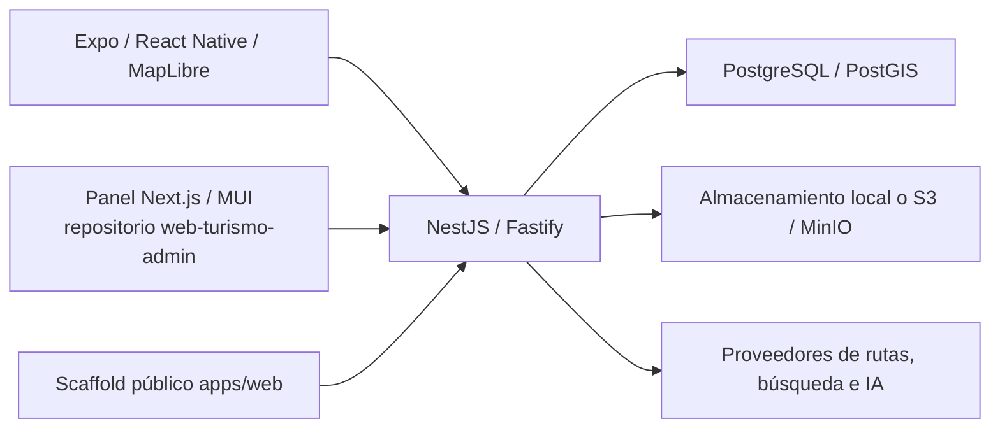

# Arquitectura de Turismo Vinculación

## Sistema actual

La API es un monolito modular. `apps/mobile` es el cliente turístico;
`web-turismo-admin` es el cliente institucional separado. `apps/web` conserva
el primer scaffold público y no contiene el panel actual.

## Mapa del código

| Área            | Fuentes actuales                                               | Responsabilidad                                          |
| --------------- | -------------------------------------------------------------- | -------------------------------------------------------- |
| API             | `apps/api/src/app.module.ts`, `main.ts`                        | Fastify, validación, módulos y OpenAPI                   |
| Identidad       | `apps/api/src/auth/`                                           | JWT, sesiones, rotación y roles                          |
| Operación       | `apps/api/src/admin/`                                          | Borradores, propiedad, revisión, publicación y auditoría |
| Público         | `centers/`, `pois/`, `establishments/`, `search/`              | Contenido publicado, búsqueda y consultas espaciales     |
| Rutas / offline | `routing/`, `transport/`, `offline/`                           | Proveedores, manifiestos y estilos acotados              |
| IA / archivos   | `ai/`, `files/`                                                | Herramientas confiables, límites y almacenamiento        |
| Móvil           | `apps/mobile/src/app/`, `core/`, `features/`                   | Navegación, estado, mapa, caché y componentes nativos    |
| Esquema         | `database/migrations/`, `turismo_vinculacion_app.sql`          | Migraciones SQL incrementales y baseline                 |
| Operación       | `scripts/`, `infra/docker/compose.local.yml`, `Dockerfile.api` | Desarrollo y empaquetado existentes                      |
| Knowledge       | `docs/`, `.agents/skills/`, `openspec/`                        | Producto, criterios, specs y cambios                     |

## Dirección de dependencias

Las features que separan capas mantienen dominio → aplicación → adaptadores:
el dominio no conoce Nest, SQL ni proveedores. Algunos servicios existentes usan
SQL directamente; la separación completa es un criterio de evolución, no una
refactorización ya realizada. Mantener parámetros SQL y transacciones explícitas.

El cliente solo consume la API y datos públicos de mapas autorizados. La API
decide permisos de registro y publicación. El modelo de IA accede a herramientas
concretas, no a SQL ni credenciales.

## Estado documentado y evolución

Las specs de `openspec/specs/` describen la base contrastada con código. Los
documentos de `docs/product/features/` conservan contexto y criterios previos;
los pendientes no se convierten automáticamente en funciones vigentes.

Redis/BullMQ, outbox, workers separados y `packages/contracts` son opciones
de arquitectura pendientes; no figuran como implementaciones de `app.module.ts`.
Los clientes actuales tienen parsers/tipos propios y Swagger se publica desde la API.
No afirmar generación automática de clientes que no tenga un generador vigente.

Leer [índice técnico](docs/architecture/index.md), [stack](docs/architecture/stack.md),
[fronteras de datos](docs/architecture/database.md) y [decisiones](docs/architecture/adr/).
