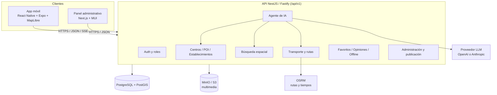
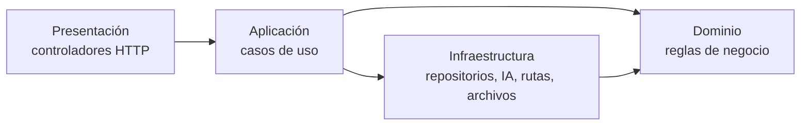
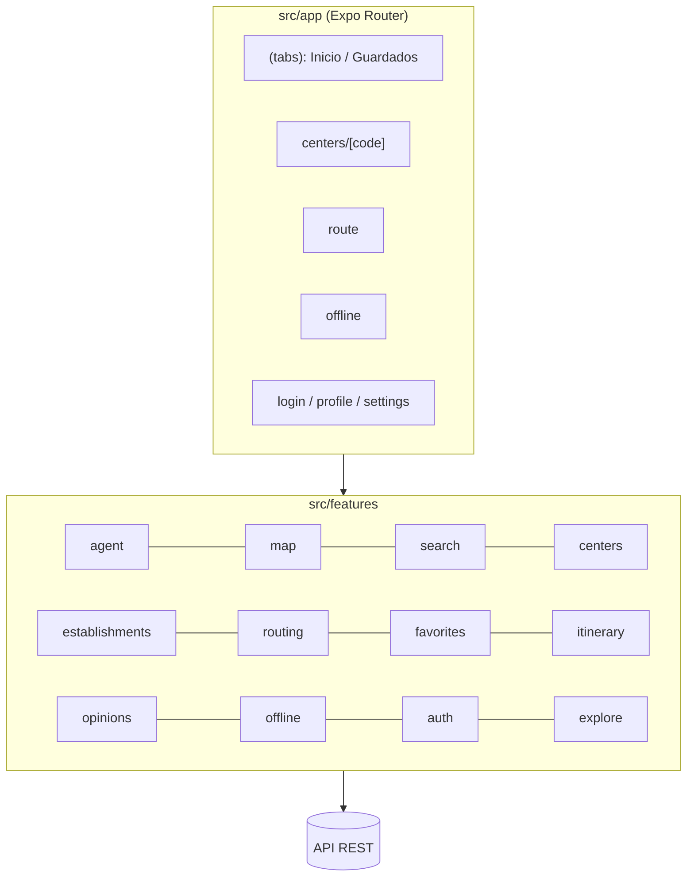
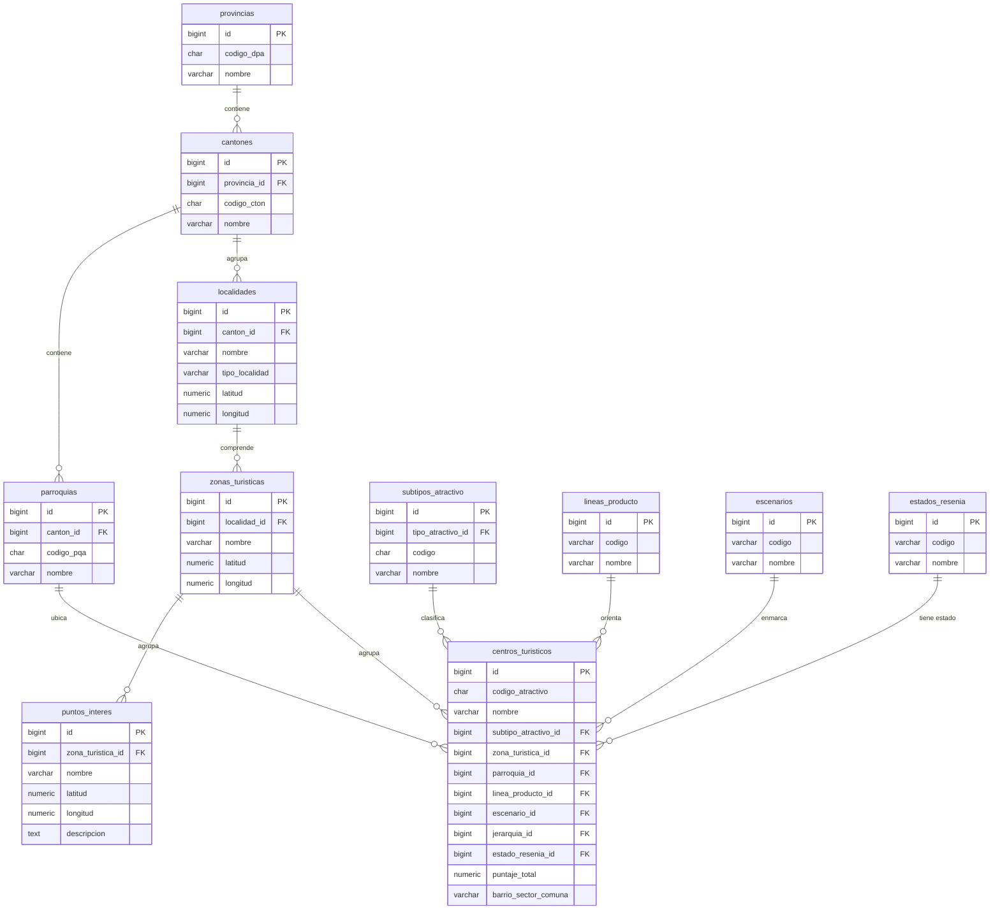
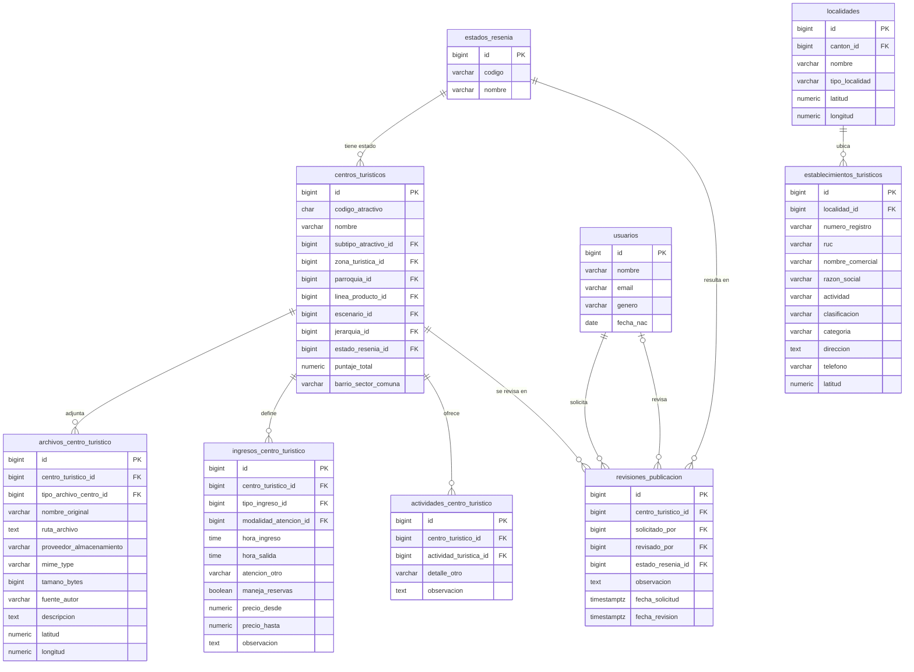
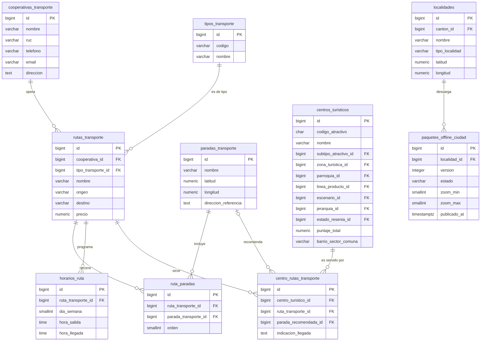
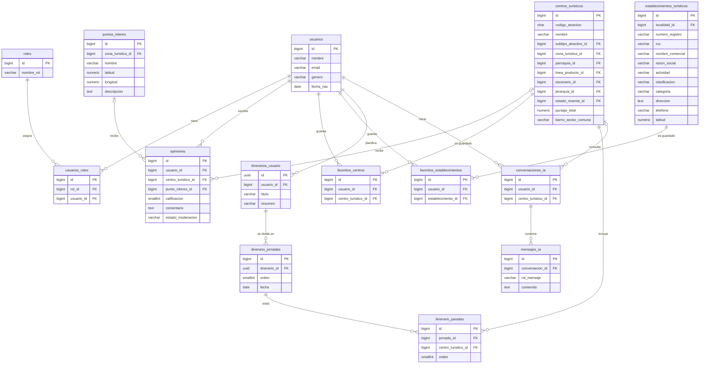
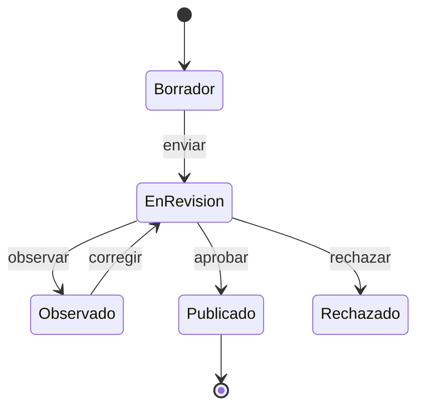

# A.2.2 Arquitectura, base de datos, interfaces y funcionalidades del aplicativo móvil

## 1. Arquitectura general

## 2. Capas del backend

## 3. Arquitectura del aplicativo móvil

Cada módulo de `features` sigue la estructura `domain / data / application / presentation`.

## 4. Modelo entidad-relación

El modelo se presenta en cuatro diagramas por módulo. Cada entidad muestra sus atributos con su tipo de dato; **PK** marca la llave primaria y **FK** la llave foránea. Los atributos de auditoría (`created_at`, `updated_at`, `activo`) se omiten por claridad.

**Notación de cardinalidad (pata de gallo):**

| Extremo de la línea | Significado |
| --- | --- |
| Dos barras (uno y solo uno) | Exactamente uno; el registro es obligatorio |
| Círculo y una barra (cero o uno) | Uno opcional; el hijo puede existir sin padre |
| Círculo y pata de gallo (cero o muchos) | Cero, uno o muchos registros |

Las relaciones de este modelo son de uno a muchos: el lado del padre lleva dos barras (o círculo y barra, si es opcional) y el lado del hijo lleva círculo y pata de gallo.

Las relaciones muchos a muchos se resuelven con tablas intermedias (`usuarios_roles`, `ruta_paradas`, `centro_rutas_transporte`).

### 4.1 Territorio y centros turísticos

### 4.2 Ficha del centro, establecimientos y publicación

### 4.3 Transporte y paquetes sin conexión

### 4.4 Usuarios, interacción e inteligencia artificial

El esquema completo tiene más de 130 tablas (ficha MINTUR, catálogos, accesibilidad, valoración y auditoría). Las migraciones están en `database/migrations/`.

## 5. Flujo de publicación de la información

Solo los centros en estado **Publicado** son visibles en la app y para el agente de IA.

## 6. Interfaces (pantallas)

| Pantalla | Ruta | Funcionalidad |
| --- | --- | --- |
| Inicio / Mapa | `(tabs)/index` | Mapa, exploración, búsqueda y acceso al agente |
| Guardados | `(tabs)/saved` | Favoritos e itinerario |
| Ficha del centro | `centers/[code]` | Detalle, fotos, opiniones y «Cómo llegar» |
| Ruta | `route` | Cálculo de ruta y navegación |
| Sin conexión | `offline`, `offline-city` | Descarga de paquetes por ciudad |
| Inicio de sesión | `login` | Autenticación |
| Perfil y ajustes | `profile`, `settings` | Cuenta y preferencias |

## 7. Principales endpoints

| Módulo | Endpoints |
| --- | --- |
| Autenticación | `POST /auth/mobile/register`, `POST /auth/mobile/login`, `POST /auth/mobile/refresh`, `POST /auth/mobile/logout`, `GET /auth/me` |
| Centros | `GET /centers`, `GET /centers/catalogs/discovery`, `GET /centers/:code` |
| Búsqueda | `GET /search` |
| Establecimientos | `GET /establishments/nearby`, `GET /establishments/tiles/:z/:x/:y`, `GET /establishments/:id` |
| Rutas | `POST /routing/route` |
| Favoritos | `GET /favorites/centers`, `GET /favorites/establishments` |
| Opiniones | `GET /centers/:code/opinions`, `POST /opinions/centers/:code` |
| Sin conexión | `GET /offline/cities`, `GET /offline/cities/:slug/manifest`, `GET /offline/map-style` |
| IA | `POST /ai/chat`, `POST /ai/chat/stream` |
| Administración | `/admin/...` (requiere rol institucional) |

La documentación completa está en OpenAPI: `http://localhost:3000/api/docs`.
