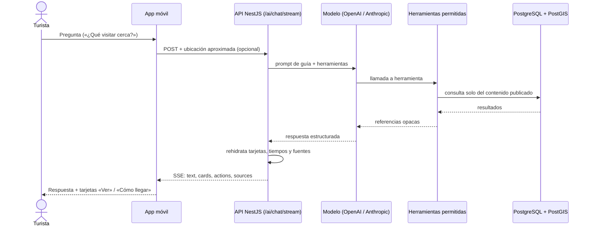

# A.2.3 Integración, configuración y ejecución del agente de IA

## 1. Flujo del agente



## 2. Herramientas del agente

| Herramienta | Función |
| --- | --- |
| `searchPlaces` | Busca centros, puntos de interés y establecimientos por texto, tipo y, con `nearby`, por radio (si no hay nada, el más cercano marcado como lejano) |
| `getPublishedCenter` | Detalle: horarios, ingresos y servicios |
| `requestLocationAccess` | Solicita permiso de ubicación |
| `getPublishedTransportForCenter` | Transporte hacia un centro |
| `searchNearbyTransportStops` | Paradas cercanas |
| `getTravelTimes` | Tiempos en auto, a pie y en bicicleta (OSRM) |
| `calculateRoadRoute` | Ruta vial con distancia e instrucciones |

## 3. Configuración

Variables en `apps/api/.env` (nunca en la app móvil):

```env
AI_PROVIDER=openai          # o anthropic
AI_MODEL=<modelo>
OPENAI_API_KEY=...          # si AI_PROVIDER=openai
ANTHROPIC_API_KEY=...       # si AI_PROVIDER=anthropic
```

## 4. Ejecución

```bash
corepack pnpm dev:local                          # BD + API + panel admin
corepack pnpm --filter @turismo/mobile android   # app móvil
```

## 5. Información validada

1. El administrador registra o importa la ficha MINTUR en el panel.
2. La ficha pasa por revisión (observación, validación del GAD y aprobación).
3. Al publicarse, la información queda disponible para el agente.
4. El agente responde únicamente con esa información y cita las fuentes.

## 6. Evidencias

**Figura 1.** Panel administrativo: inventario de centros turísticos con el estado de cada ficha (publicado / en revisión).

IMG|evidencias/01-admin-fichas.png|16

**Figura 2.** Panel administrativo: ficha de la Catedral San Pedro de Guaranda, con avance por apartados y observación de revisión.

IMG|evidencias/02-ficha-publicada.png|16

**Figura 3.** Documentación OpenAPI con los endpoints del agente (`/ai/chat`, `/ai/chat/stream`).

IMG|evidencias/03-openapi-ai.png|16

**Figuras 4 a 6.** Aplicación móvil: mapa con centros, ficha del centro y ruta «Cómo llegar».

IMGROW|evidencias/04-app-mapa.png|evidencias/05-app-ficha.png|evidencias/08-ruta.png

**Figuras 7 y 8.** Agente de IA: respuesta con tarjetas de lugares publicados y consulta «cerca de mí» con tiempos de viaje.

IMGROW|evidencias/06-agente-respuesta.png|evidencias/07-agente-cercania.png

**Figura 9.** Pruebas automatizadas del agente en el cliente móvil (8 archivos, 65 pruebas aprobadas).

IMG|evidencias/09-tests.png|16
